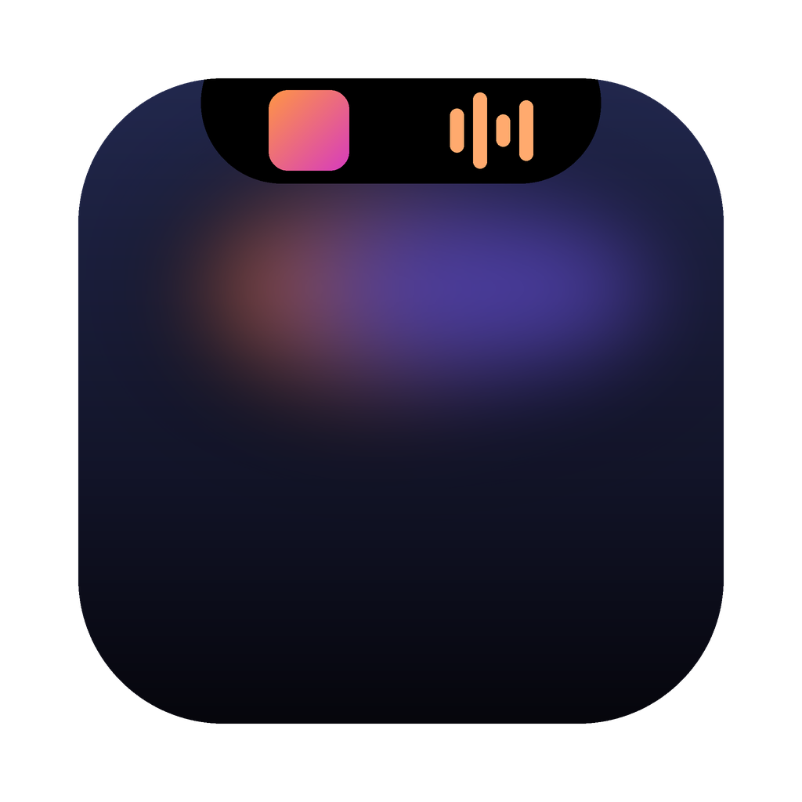

<p align="center">
  
</p>

<h1 align="center">Muesca</h1>

<p align="center"><b>La isla dinámica para el notch de tu Mac.</b><br>
Música, agenda, tiempo, volumen, brillo y el estado del sistema, a un vistazo.</p>

<p align="center">
  <a href="#español">Español</a> · <a href="#english">English</a>
</p>

---

## Español

Muesca convierte el notch del MacBook —o el centro de la barra de menús en un monitor externo— en una isla dinámica, al estilo de la del iPhone. Cerrada te muestra lo importante; al pasar el ratón se despliega.

### Qué hace

**La isla cerrada**
- **Música**: carátula y ecualizador del color del disco (Spotify y Música de Apple).
- **En reposo**: tiempo, hora, fecha y batería.
- **Volumen y brillo**: sustituye el indicador de macOS. El brillo se aplica a la pantalla donde está el puntero, incluidos monitores externos (DDC).
- **Reuniones**: cuenta atrás desde 5 minutos antes y aviso durante toda la reunión.
- **Temporizador** (Pomodoro) y **avisos del sistema**: CPU al máximo, Mac caliente o poco disco.
- **Privacidad**: punto verde o naranja cuando se usan la cámara o el micrófono.

**La isla abierta**
- **Música**: carátula, letras sincronizadas, barra arrastrable, controles, gestos con el trackpad, salida de sonido (Bluetooth y AirPlay) y volumen. La isla se tiñe con los colores dominantes de la portada.
- **Rendimiento**: CPU, presión de memoria, GPU, disco, salud y consumo de la batería, gráficas del último minuto y las apps que más consumen.
- **Bandeja de archivos**: arrastra archivos al notch y sácalos donde los necesites; envío por AirDrop, Mensajes u Outlook.
- **Agenda**: próximos eventos o mes en cuadrícula, con botón «Unirse» para Teams, Meet, Zoom y Webex.
- **Herramientas**: mantener el Mac despierto y temporizador.

**A tu medida**: MacBook, monitores externos o todas las pantallas; siempre visible u oculta hasta pasar el ratón; idioma automático (español o inglés); abrir al iniciar sesión; ayuda integrada.

### Requisitos
- macOS 13 o posterior, en Mac con chip Apple o con procesador Intel (la app es universal).
- Para compilarla: las Command Line Tools de Xcode (`xcode-select --install`). **No hace falta Xcode.**

### Instalación

**Opción A — Compilar (recomendada)**
```bash
git clone https://github.com/joteogarcia/muesca.git
cd muesca
./build.sh --install
```
El script compila, firma, copia la app a Aplicaciones y la abre.
Para generar la app universal (chip Apple + Intel) y su `.zip`: `./build.sh --universal`.

**Opción B — Descargar la app**
Descarga el `.zip` de la última versión en [Releases](https://github.com/joteogarcia/muesca/releases). Como no está firmada con una cuenta de desarrollador de Apple, la primera vez macOS mostrará un aviso: ve a **Ajustes del Sistema → Privacidad y seguridad** y pulsa **«Abrir igualmente»**. Solo hay que hacerlo una vez.

### Permisos
Muesca los pide una sola vez y solo para lo que los necesita:
- **Automatización**: Spotify, Música y Outlook.
- **Calendarios** y **ubicación aproximada** (para el tiempo).
- **Accesibilidad**: solo si activas «Sustituir el HUD del sistema».
- **Bluetooth**: para conectar auriculares desde el menú.

> Consejo: si creas un certificado de firma propio llamado «Muesca Code Signing» en tu llavero, `build.sh` lo usará y macOS no volverá a pedir los permisos tras cada compilación.

### Privacidad
Todo funciona en tu Mac. Muesca no tiene cuentas, ni analítica, ni envía datos personales. Solo se conecta a servicios públicos y gratuitos: [Open-Meteo](https://open-meteo.com) y [MET Norway](https://api.met.no) para el tiempo, y [LRCLIB](https://lrclib.net) para las letras.

### Cómo se hizo
Muesca nació el 2 de noviembre de 2026 con una pregunta a una IA: «¿podrías hacer una notch island para Mac?». Está escrita en Swift y SwiftUI, sin Xcode, en conversación con Claude (Anthropic): cada versión salió de una petición concreta y se compiló y probó en el propio Mac.

### Licencia
[MIT](LICENSE) © 2026 Jorge Oteo

---

## English

Muesca turns your MacBook's notch —or the centre of the menu bar on an external display— into a dynamic island, like the iPhone's. Closed, it shows what matters; hover over it and it opens.

### Features
- **Music**: Spotify and Apple Music with artwork, synced lyrics, a seekable progress bar, trackpad gestures, and an island tinted with the album's dominant colours.
- **Sound**: output switching (Bluetooth and AirPlay) and volume.
- **Volume & brightness HUD**: replaces the macOS overlay; brightness follows the screen under the pointer, including external displays (DDC).
- **Agenda**: upcoming events or a month grid, meeting countdowns, and a **Join** button for Teams, Meet, Zoom and Webex.
- **File shelf**: drop files on the notch and drag them out later; share via AirDrop, Messages or Outlook.
- **System monitor**: CPU, memory pressure, GPU, disk, battery health and power draw, last-minute graphs, top apps, and alerts.
- **Tools**: keep the Mac awake, Pomodoro timer, camera/microphone indicator.
- Works on the built-in display, external displays, or all of them; Spanish and English UI following macOS.

### Install
```bash
git clone https://github.com/joteogarcia/muesca.git
cd muesca
./build.sh --install
```
Universal app (Apple silicon and Intel). Requires macOS 13+ and the Xcode Command Line Tools (`xcode-select --install`). No Xcode needed. A prebuilt `.zip` is available under [Releases](https://github.com/joteogarcia/muesca/releases); since it isn't notarized, open it once via **System Settings → Privacy & Security → Open Anyway**.

### Privacy
Everything runs locally. No accounts, no analytics. Network access is limited to Open-Meteo / MET Norway (weather) and LRCLIB (lyrics).

### License
[MIT](LICENSE) © 2026 Jorge Oteo
